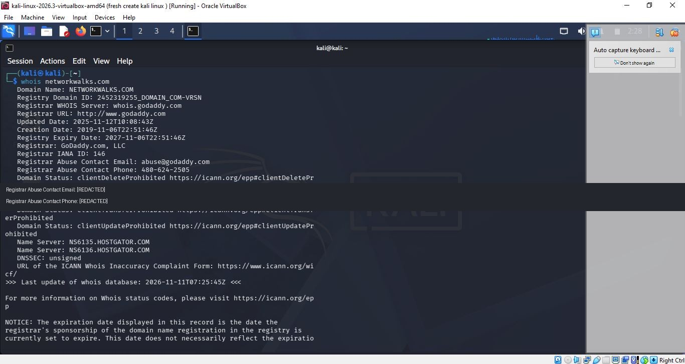

# WHOIS — Domain Registration Lookup

## Objective
Learn how WHOIS can return publicly available domain registration and registrar information.

## Command
```bash
whois networkwalks.com
```

## Observations from this run
- Registrar shown: GoDaddy.com, LLC
- Name servers shown: `NS6135.HOSTGATOR.COM` and `NS6136.HOSTGATOR.COM`
- Domain creation date shown: `2019-11-06`
- Registry expiry date shown: `2027-11-06`
- DNSSEC status shown: unsigned

## What I learned
WHOIS can help identify registrar details, domain lifecycle dates, domain status codes, and delegated name servers. Registration records may be privacy-protected or change over time.

## Evidence


## Notes
The screenshot has been sanitized to hide registrar abuse contact details. WHOIS output is time-sensitive and should be treated as a snapshot, not a permanent fact.
