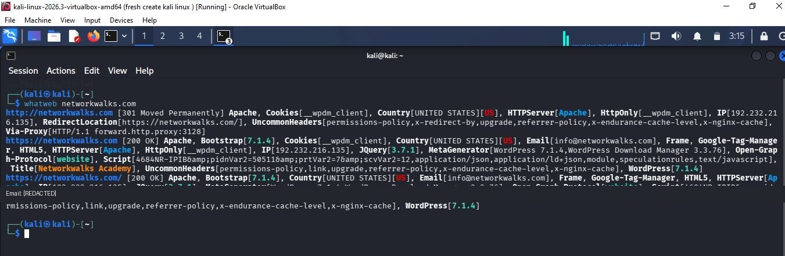

# WhatWeb — Website Technology Fingerprinting

## Objective
Practice identifying technologies that are observable from a website response.

## Command
```bash
whatweb networkwalks.com
```

## Observations from this run
The captured output reported:
- Apache as the HTTP server
- WordPress
- Bootstrap 7.1.4
- jQuery 3.7.1
- WordPress-related metadata and plugins

The output showed both a redirect response and a successful HTTPS response.

## What I learned
WhatWeb fingerprints technologies based on observable response characteristics. Its results are indicators, not proof that every detected component is installed or currently used in every part of a site.

## Evidence

