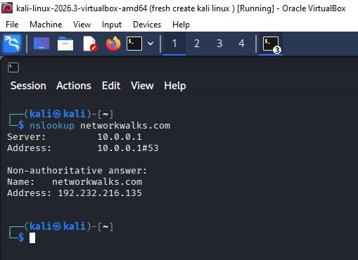

# nslookup — DNS Name Resolution

## Objective
Use a DNS lookup utility to resolve a domain name to an IP address.

## Command
```bash
nslookup networkwalks.com
```

## Observations from this run
- Configured DNS resolver: `10.0.0.1`
- Returned domain address: `192.232.216.135`
- The response was labelled non-authoritative.

## What I learned
A DNS resolver can answer a query using cached or recursively obtained information. A non-authoritative answer does not mean the answer is invalid; it means the responding server is not the authoritative source for that zone.

## Evidence

