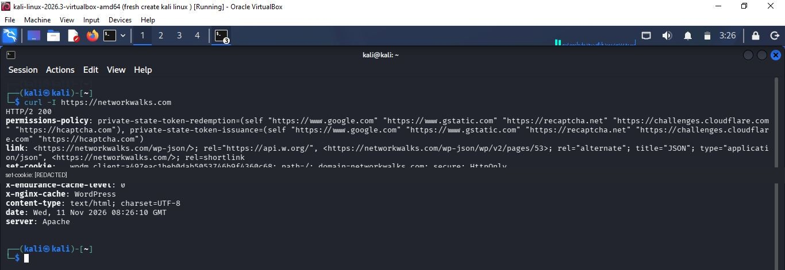

# cURL — Inspecting HTTP Response Headers

## Objective
Inspect the HTTP response headers returned by a website.

## Command used
```bash
curl -I https://networkwalks.com
```

## Observations from this run
- HTTP status: `200`
- Protocol shown: HTTP/2
- Content type: `text/html; charset=UTF-8`
- Server header: `Apache`
- Response included WordPress-related links and cache headers.

## What I learned
The `-I` option requests headers only (a HEAD request). The status code and headers provide useful information about the server's response and configuration. Header values can be hidden, changed, or generated by proxies and should not be treated as definitive proof of the backend architecture.

## Evidence


## Command distinction
This screenshot shows `curl -I`, not `curl -i`. `-I` requests headers only; `-i` includes response headers in the output alongside the response body.
