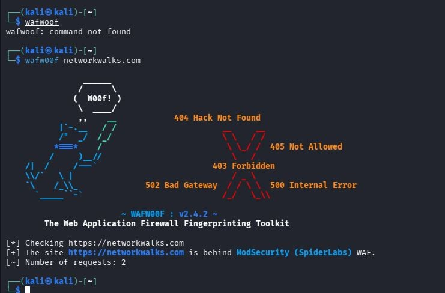

# WAFW00F — Web Application Firewall Fingerprinting

## Objective
Practice using WAFW00F to check whether a web application firewall can be fingerprinted.

## Commands attempted
```bash
wafwoof
wafw00f networkwalks.com
```

## Observations from this run
- The first command failed with `command not found` because the command was misspelled.
- The correctly spelled command ran successfully.
- WAFW00F v2.4.2 reported: `ModSecurity (SpiderLabs) WAF`.
- The tool reported 2 requests.

## What I learned
Exact command spelling matters in Linux. WAFW00F sends requests and compares responses to known WAF characteristics. Its identification is a tool finding, not a full security assessment.

## Evidence

