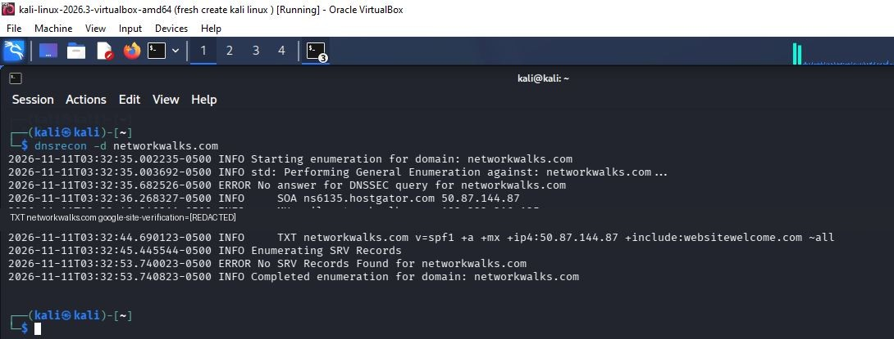

# DNSRecon — DNS Enumeration

## Objective
Explore DNSRecon's general enumeration mode and record the DNS information returned.

## Command
```bash
dnsrecon -d networkwalks.com
```

## Observations from this run
- SOA record reported: `ns6135.hostgator.com`
- MX record reported: `mail.networkwalks.com`
- TXT records included a Google site-verification value and an SPF policy.
- DNSSEC query returned a `No answer` message.
- No SRV records were found by this run.

## What I learned
DNSRecon can collect several DNS record types in one run. A missing answer for a DNSSEC query or no SRV records found is not, by itself, proof of a vulnerability.

## Evidence


## Data handling
The Google site-verification token has been redacted from the screenshot. Avoid publishing tokens or other values that could be used for account or domain verification.
